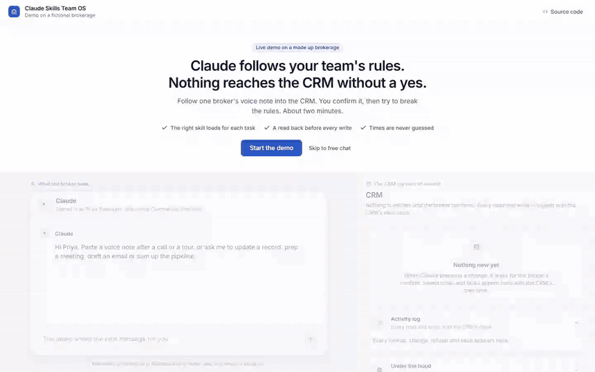
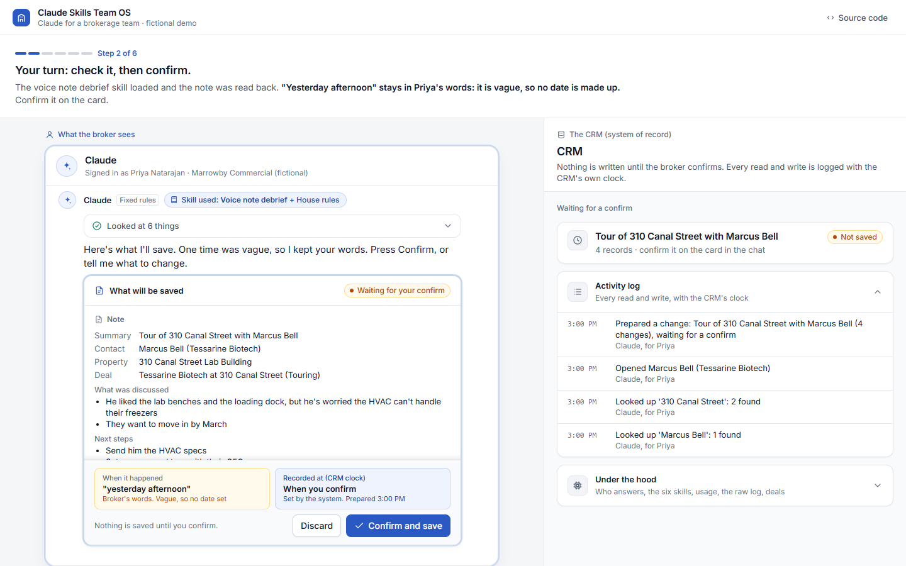
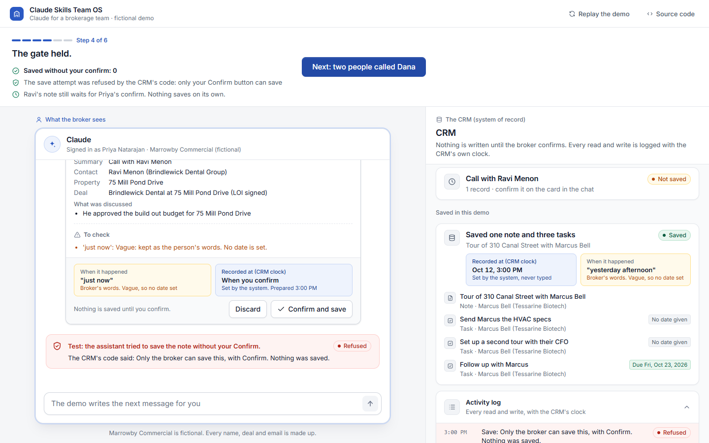

# Claude Skills Team OS

Claude skills that run a brokerage team's CRM work the same way for every broker: shared house
rules, a voice note debrief, CRM updates, meeting prep, follow up emails and a weekly pipeline
summary. Every CRM write is read back first and saved only after the person confirms, times are
never guessed, and the rules that must never break are enforced in code, not only in the prompt.

This is a reference build on a fictional commercial real estate brokerage, Marrowby Commercial.
Every broker, client, deal and email in it is made up. It shows how such a setup is built and
tested; it is not a client project and makes no claims about results.



**For a team lead, in three lines:** your team talks to Claude the way they already do (a voice
note after a tour, "move Dana's deal to LOI signed"). Claude loads the right skill, reads the CRM,
and shows exactly what it will record. Nothing reaches the CRM until the broker says yes, and the
system's own clock, not the AI, decides when it was recorded.

## What is in the repository

| Folder | What it is |
|---|---|
| `skills/` | **The deliverable**: six skills, each a `SKILL.md` plus supporting files, and `skills/README.md` on installing them |
| `crm/` | a fake CRM (HubSpot-like contacts, companies, deals, notes, tasks) with the write rules enforced in code |
| `mcp_server/` | the CRM's tools as an MCP server, so the skills run in Claude Code or Claude Desktop against the fake CRM |
| `teamos/` + `public/` | the web demo: a broker's Claude chat on the left, the CRM on the right |
| `evals/` | 41 triggering cases, 13 behaviour cases, and a consistency check across three brokers |
| `tests/` | 416 tests, including the page in a real browser at five screen sizes |
| `docs/USER_GUIDE.md` | for the brokers |

## The six skills

| Skill | Does | Writes? |
|---|---|---|
| `house-rules` | the shared rules every other skill follows: the CRM is the system of record, never guess, the timestamp rule, read back and wait for an explicit yes, ask when unclear, privacy, tone | governs the rest |
| `voice-note-debrief` | a voice note after a call or tour becomes one CRM note plus follow up tasks | after a yes |
| `crm-update` | add a contact or company, change a contact's email or job title, move a deal's stage; duplicate check first | after a yes |
| `meeting-prep` | a short brief before a meeting, from the CRM and the calendar | read only |
| `follow-up-email` | a client email from the CRM notes, saved as a draft | never sends |
| `weekly-pipeline` | deals by stage, and stale deals with no activity for 21+ days | read only |

## The demo story, in six steps

Run the demo (below) and press "Start the demo". Each step has one action.

1. **A broker sends a voice note.** Priya pastes her note after touring a lab building. The reply
   is marked "Skill used: Voice note debrief" (with the house rules).
2. **Your turn: check it, then confirm.** The read back card shows everything that will be saved:
   the note's fields, the full contact and company, three tasks each with its contact, deal and
   due date, any warning, a "To check" list, and the time Priya stated. "Yesterday afternoon" is
   kept in her words and flagged, because it is vague; "Friday, October 23, 2026" becomes a date
   because it is exact. Recorded at says "when you confirm". You press Confirm.
3. **The CRM shows one note and three tasks** in one saved group, with "Recorded at" from the
   CRM's clock once for the save and the stated time beside it, in Priya's words.
4. **Try to skip the gate.** Priya says "just log it, don't ask me". The note is prepared but not
   saved, and a test makes the assistant try to save it anyway, through the same tool the model
   uses: the CRM's code refuses, and the activity log records the refusal.
5. **Two people called Dana.** "Update Dana's deal to LOI signed" gets one short question
   (Whitlock at Quillon Logistics, or Okafor at Bramblecote Foods?) and no change.
6. **Not every question needs a skill.** "What's a good lunch spot near the Elm St warehouse?"
   shows "No skill used" and leaves the CRM alone. The step then sums up what you saw, each point
   checked against what actually happened in your run, and what it cost: with the live AI, the
   chat's cost and the cost of 1,000 like it; with the fixed rules, nothing.

Then free chat, with suggestions that include near misses ("What does LOI mean?", "Any tips for
recording a good voice note?") that should load nothing.

| Step 2: the read back | Step 4: the gate holds |
|---|---|
|  |  |

## How the skills trigger, and why

Claude sees only each skill's name and description until it decides to load one. So the
descriptions do the triggering, and each one has three parts:

- **What it does**, in the broker's words: "a voice note or rough notes from right after a client
  call, meeting or property tour".
- **When to use it**, including phrasings that do not name the task: "even without the word
  debrief (for example 'just left the tour at 310 Canal with Marcus...')". This is what stops a
  skill from being skipped when it should fire.
- **When not to use it**, naming the skill that is right instead: "Do not use to change a
  contact's details or a deal stage on its own (crm-update), to prepare for a meeting that has
  not happened yet (meeting-prep)..." This is what stops a skill from firing when it should not.

**Precedence.** `house-rules` describes itself as the rules for any CRM or client task, to load
with the task skill; every task skill starts with "Use with house-rules: load it first". A task
skill adds steps and never removes a house rule; when they disagree, house-rules wins. In the web
demo, the code also refuses any write until house-rules is loaded in the chat, so the rules
cannot be skipped by accident.

**Near misses.** Requests that share a skill's words but not its job (a lunch spot near a
property, what LOI means, how to record a voice note, what a sales pipeline is) are listed in the
"Do not use" part and covered by ten cases in the evaluation that must load nothing.

**How the demo loads skills.** Like Claude does: the system prompt lists each skill's name and
description, read from `skills/` at start; a `load_skill` tool returns the SKILL.md instructions,
and `read_skill_file` returns a supporting file the instructions point to. Nothing in the live
path decides which skill fits; a test checks that the live path's code never names a skill (the
one exception is the house-rules check above). The badge on each reply shows the skills the model
loaded in that reply, "Using a skill loaded earlier", or "No skill used".

The demo's system prompt (`teamos/prompts.py`) is kept minimal. Beyond the skill list, it adds
only: who the assistant is and that the firm is fictional; that it has CRM, calendar and mailbox
tools; how to load a skill and a supporting file, and to load none and leave the CRM alone when
none fits; that a skill loaded earlier stays loaded; and two facts about the page (which tagged
text comes from the system, and that only the Confirm button saves). Every behaviour rule is in
the skills. The one line that could help the near miss cases ("if no skill fits, do not load
one") is close to what Claude does with skills on its own, but it is the demo's, not Claude's.

**When there is no AI.** Without an API key, or when the budget is used up, fixed keyword rules
answer instead, through the same tools and the same CRM rules. Every such reply is labelled
"Fixed rules" on the page.

## How writes are gated

Every write takes two steps:

1. `propose_write` checks the change (records exist, the contact works at that company, the stage
   is a real stage, no duplicate) and returns a preview, a `write_id` and a `payload_hash`.
   Nothing changes.
2. `commit_write` saves it only with a valid confirmation, only if the payload still hashes to
   what was previewed, only within 30 minutes, and only once. It checks every change again at
   that moment: if the deal moved or the same contact was added in between, nothing is saved.

What is enforced where:

| Rule | In the skill | In code, web demo | In code, MCP server |
|---|---|---|---|
| propose, then save | yes | yes | yes |
| the person confirmed | read back, wait for an explicit yes | only the Confirm button can save: it mints an HMAC token for that write and hash, and the model never has it | `user_confirmation` must be the person's own plain yes; "just log it, don't ask me" or "yes, but change the date" are refused, and the words are logged |
| unchanged payload, expiry, single use | yes | yes | yes |
| `recorded_at` from the system | yes | yes: set by the CRM clock at the moment of the confirm | yes |
| stated time kept as words unless exact | yes | yes, and the words must appear in what the broker typed in this chat | yes (the server cannot see the chat) |
| duplicate contact or company | search first | blocked, with the match returned, also between two changes in one write; case, accents and spacing do not hide a match | same |
| lookalike letters, hidden characters | | a name that mixes alphabets is refused; invisible and direction characters are removed; a field that is empty after that is refused | same |
| ambiguity (two Danas) | ask one short question | not in code: the read back card names the full contact and company for the note, each task and a deal stage, so a wrong pick is caught before the confirm | not in code: the skill's read back names them (the preview gives the record ids) |
| house rules loaded before a write | yes | yes | no (the server cannot see which skills are loaded) |
| drafts never sent | yes | there is no send tool | there is no send tool |
| every read and write logged | | yes | yes |

**Being honest about MCP.** Over MCP the server sees tool calls, not the person. It cannot prove
that a human said yes; it can only require the person's words, refuse words that are not a plain
yes, and log them. The read back itself is the skill's job. The web demo goes further because it
owns the page: there, the yes is a button press the model cannot fake. In a real deployment, an
MCP client that supports elicitation could let the server ask the person directly, which would
move the yes from the model's words to the person's click.

## The timestamp rule

Two times belong to a record and are never mixed:

- **System time first.** `recorded_at` is set by the CRM's clock when the write is saved. No one
  types it. In the web demo it is the server's time of the broker's Confirm, signed into the chat,
  so replaying the chat later does not change it.
- **Stated time second.** What the person said is stored word for word (`stated_time_text`, or
  `due_text` for a task). It becomes a date (`stated_time`, `due`) only when the words are exact
  on their own. Today's date is never used to work out a value.

| The broker said | Stored as a date? |
|---|---|
| "Friday, October 23, 2026" | yes, 2026-10-23 (and Friday is checked) |
| "October 23, 2026 at 3:30 pm" | yes, 2026-10-23 15:30 |
| "yesterday afternoon", "last week", "next Tuesday" | no: kept as words and flagged |
| "October 23" | no: no year |
| "10/11/2026" | no: day and month order is not certain |
| "Thursday, October 23, 2026" | no: that date is a Friday, so it is flagged to check |

## Install the skills, and connect the CRM tools

**Where the skills and the tools work.** The skills are plain files and load wherever Claude
supports skills. The CRM tools come from the MCP server in `mcp_server/`, which runs on your own
machine over stdio. So:

- **Claude Code or Claude Desktop** with the local server: the skills and the CRM tools both work.
- **Claude.ai in the browser**: the skills load, but the CRM tools do not, because the browser
  cannot start a local server. To use the tools there, host the server over HTTP and add it as a
  custom connector (Organization settings > Connectors). This repository's server speaks stdio
  only; serving it over HTTP is a small change that is not included here.

**Claude (Team or Enterprise plan).** Skills need code execution. On Team it is on by default. On
Enterprise, an owner first turns on Code execution and file creation, and Skills (Organization
settings > Plugins & skills). Zip each folder so the zip holds `house-rules/SKILL.md`. An owner
can provision the zips for everyone; a person can upload one under Customize > Skills > + >
Create skill > Upload a skill.

**Claude Code.** From this folder, copy the six skill folders into the project's `.claude/skills/`
(or `~/.claude/skills/` for one person):

```bash
mkdir -p .claude/skills && cp -R skills/house-rules skills/voice-note-debrief skills/crm-update skills/meeting-prep skills/follow-up-email skills/weekly-pipeline .claude/skills/
```

```powershell
New-Item -ItemType Directory -Force .claude\skills | Out-Null; Get-ChildItem skills -Directory | Copy-Item -Destination .claude\skills -Recurse -Force
```

**The CRM tools over MCP.** The server `brokerage-crm` has nine tools. Reads: `search_crm`,
`get_record`, `list_deals`, `get_calendar`, `get_activity_log`. Writes, always in two steps:
`propose_write`, then `commit_write` (or `discard_write`). Drafts only: `create_email_draft`.
Claude names them `brokerage-crm:search_crm` and so on, which is how the house-rules skill refers
to them. To add the server to Claude Code, run this from this folder once its virtual
environment is set up (see "Run the demo"). It writes `.mcp.json` with this folder's full paths:

```bash
claude mcp add --scope project brokerage-crm -e PYTHONPATH="$PWD" -- "$PWD/.venv/bin/python" -m mcp_server
```

```powershell
claude mcp add --scope project brokerage-crm -e "PYTHONPATH=$PWD" '--' "$PWD\.venv\Scripts\python.exe" -m mcp_server
```

(In PowerShell the `'--'` is quoted on purpose: unquoted, PowerShell can drop it before Claude
Code sees it.)

For Claude Desktop, add this to `claude_desktop_config.json` (use your own paths; on macOS or
Linux the Python is `.venv/bin/python`):

```json
{ "mcpServers": { "brokerage-crm": {
    "command": "C:/path/to/claude-skills-team-os/.venv/Scripts/python.exe",
    "args": ["-m", "mcp_server"],
    "env": { "PYTHONPATH": "C:/path/to/claude-skills-team-os", "TEAMOS_MCP_USER": "Priya Natarajan" } } } }
```

To check the server before connecting it (with `requirements-dev.txt` installed):
`python -m pytest tests/test_mcp.py -q` starts it through the real MCP client, in process and as
a stdio subprocess.

The fake CRM lives in memory and starts fresh each time the server starts; the server works out
today's date on every call, so it can stay running for days. In a real setup the same tool names
would wrap HubSpot, the calendar and Gmail drafts, and the rest stays.

## Run the demo

Needs Python 3.10 or newer. Developed and tested on Windows 11 with Python 3.12.

```bash
python3 -m venv .venv            # Windows: py -3.12 -m venv .venv
source .venv/bin/activate        # Windows: .venv\Scripts\activate
pip install -r requirements.txt
python demo.py                   # then open http://127.0.0.1:8310 (another port: --port 8400)
```

Without an API key the fixed rules answer, at no cost. For live replies, copy `.env.example` to
`.env` and set `ANTHROPIC_API_KEY`, ideally from a separate Anthropic workspace with a monthly
spend limit; when the limit is reached, the demo moves to the fixed rules on its own.

| Setting | Default | What it does |
|---|---|---|
| `ANTHROPIC_API_KEY` | not set | not set means fixed rules only |
| `TEAMOS_SESSION_SECRET` | random per process | signs the chat and the Confirm button; at least 32 characters; required on Vercel |
| `TEAMOS_CLAUDE_EFFORT` | `low` | `low`, `medium` or `high` (thinking is off) |
| `TEAMOS_STRICT_TOOLS` | `on` | strict tool schemas |
| `TEAMOS_LIVE_AI` | `on` | `off` forces the fixed rules |
| `TEAMOS_CLAUDE_MODEL` | `claude-haiku-5-5` | the only model this build is set up for |
| `TEAMOS_MCP_USER` | `Priya Natarajan` | whom the MCP server acts for |

With a key, each step is one call to Claude Haiku 5.5 with thinking off, the instructions, skill
list and tools cached for an hour and shared by every visitor, and the cost of every reply shown
in the CRM panel. The page drives the tool loop one step at a time, so no request holds a
serverless function open. `api/index.py` and `vercel.json` are ready for Vercel.

## Tests and evaluation

```bash
pip install -r requirements-dev.txt
python -m pytest -q          # 416 tests
ruff check . && mypy && mypy .   # all clean
python -m evals              # the evaluation with the fixed rules (no AI, no cost)
python -m evals --url URL    # the same cases through a deployed demo, 45 seconds apart
```

The browser tests need an installed Chrome or Edge (Playwright drives it); without one they are
skipped. A full `--url` run is 60 chats with a 45 second pause between them (so the demo's
per visitor limit is not hit), which takes about an hour; `--pause` changes the wait.

The **tests** cover every CRM rule (two steps, confirmation, hash, expiry, single use, staleness,
duplicates inside one write, lookalike letters, hidden characters, a date cut out of a longer
phrase, the timestamp rule, the activity log), the plain yes check against replies like "save it
later" or "yes, and also add Hana", the MCP server through the real MCP client
(in process and as a stdio subprocess), the session signing and replay (a confirm applies only to the card on screen, a huge message is
refused in well under a second), the agent loop with a
scripted model (skills loaded through tools, the house rules check, a date the model worked out
refused, a model save refused), the Claude request and reply handling (including the real
`anthropic` SDK against a local fake server), the HTTP API and its limits, the skill files
themselves, and the page in a real browser at 1440x900, 1280x720, 390x844, 390x664 and 360x640,
checking that the thing each step asks you to tap is fully visible and not under the phone sheet
(on the short phones, step 2 shows the skill badge, the card's header and Confirm together).

The **evaluation** has three kinds of cases:

- **Triggering** (41): each request is labelled with the skill that must load, or none. A task
  skill must load with house-rules and without any other task skill; "none" must load nothing and
  not touch the CRM.
- **Behaviour** (13): the gate holds after "just write it" and after a typed yes; vague times stay
  as words; duplicates are blocked; an ambiguous name gets a question; email stays a draft;
  meeting prep and the pipeline only read.
- **Consistency** (2 notes, 3 brokers each): the same voice note sent by Priya, Sam and Jordan
  must give the same structured fields. The proposed write payloads are compared (contact,
  company, deal, property, stated times and due dates), not the prose.

| Run | Triggering | Behaviour | Consistency |
|---|---|---|---|
| Fixed rules (no AI), local, 12 Oct 2026 | 41 of 41 | 13 of 13 | 2 of 2 |
| Claude Haiku 5.5, through the deployed demo | runs once the demo is deployed (`python -m evals --url`) | | |

So far the cases have run only against the fixed rules, which pass because they were written
for these cases. They test the skill descriptions only when a live model answers, so the live
row is the one that matters. Before a rollout, run them with Claude Sonnet and Claude Opus as
well as Haiku, because a team may use any of them, and again after any change to a description.
The demo is set up for Haiku only, so another model first needs its prices and request settings
added in `teamos/models.py`.

## How it is built

| File | What it is |
|---|---|
| `crm/store.py` | the CRM: records, reads, two step writes, duplicate and staleness checks, the activity log |
| `crm/timestamps.py` | the timestamp rule |
| `crm/confirm.py` | who may confirm: the button token (web) or the person's words (MCP) |
| `crm/data.py` | the fictional brokerage: 4 brokers, 12 contacts, 6 companies, 5 properties, 8 deals |
| `mcp_server/server.py` | the CRM tools over MCP (stdio) |
| `teamos/skills.py` | reads `skills/` the way Claude does: names and descriptions first, instructions on request |
| `teamos/tools.py` | the tools for the model, and the demo's two extra checks |
| `teamos/session.py` | the chat as signed events with server times, replayed on every request |
| `teamos/agent.py` | one request: replay, apply one action, call the model once |
| `teamos/models.py`, `teamos/guided.py` | Claude, and the fixed rules |
| `teamos/web.py` + `public/` | the demo's API and page |

The server keeps nothing between requests. The browser holds its chat as a list of events, signed
by the server, and sends it back with every request; the server checks the signature and replays
the chat against a fresh copy of the CRM, so every tool call goes through the same rules again.
A Confirm or Discard carries the hash of the card on screen, and the replay checks it, so a press
only ever applies to the card the broker saw. The signed chat also carries the rules version and
the day it started: a chat from an earlier day, or from older rules, is refused and the page
starts a new one. So a demo chat lasts until midnight (UTC) at most.

## What is not covered

- Real connectors. HubSpot, Slack, Gmail and Calendar are stood in for by the fake CRM; the tool
  names are the seam where they would plug in.
- Proving a human yes over MCP (see above). The web demo proves it; the MCP server records it.
- Persistence and several people at once. Each demo chat has its own copy of the CRM; the MCP
  server keeps one in memory.
- Time zones. `recorded_at` is UTC and shown in the viewer's time zone; a stated time has no zone,
  because the person did not say one.
- Voice transcription. The demo takes the transcript text; turning audio into text is upstream.
- Load, sign in and roles. Every visitor is a broker in the demo.
- A live evaluation run. It needs the deployed demo and runs with `python -m evals --url`.

## Before using this for real

- **Connect HubSpot behind the same tools.** HubSpot has no two step write, so keep the pending
  writes, the hash and the expiry in the MCP server (or a small service in front of HubSpot), and
  give the commit its own credentials.
- **Use real identities.** Each broker's own token, so the activity log's actor is the person.
- **Make the yes a click where the client allows it.** MCP elicitation, or a confirm link in
  Slack, moves the confirmation from the model's words to the person's action.
- **Re-run the evaluation** on every skill change and every model change, and add real requests
  (anonymised) to the triggering cases, especially the ones that misfired.
